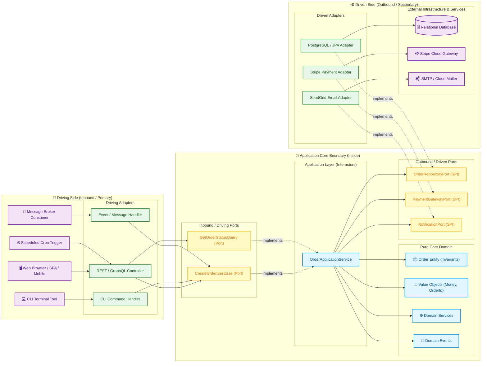
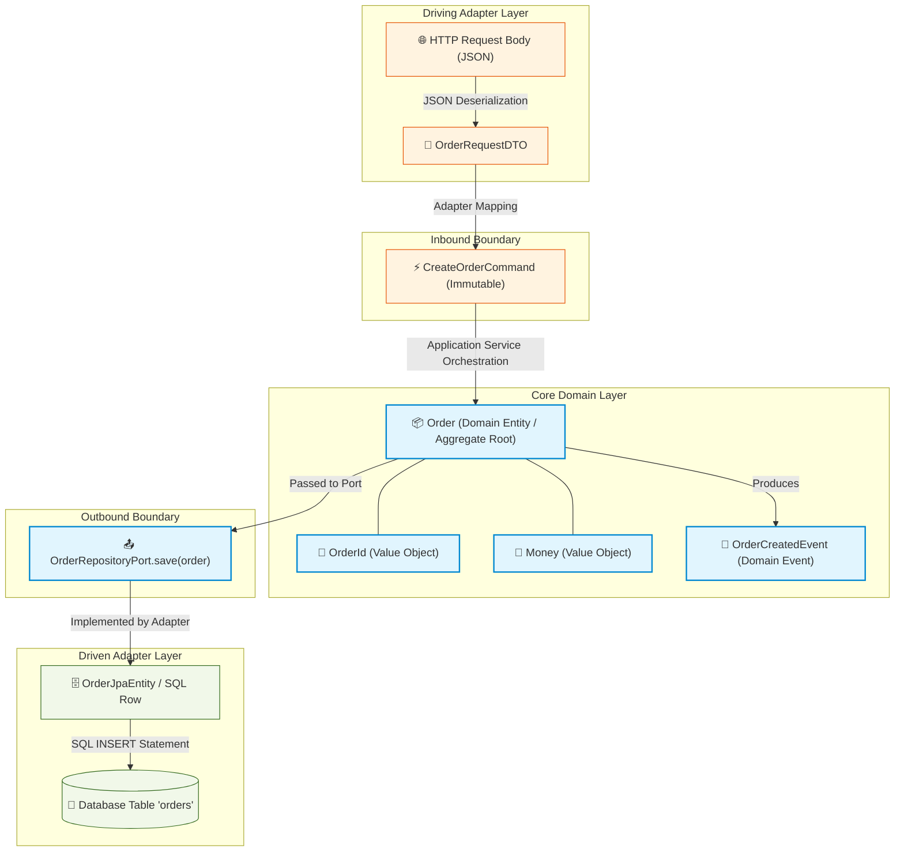

# ⬡ Hexagonal Architecture (Ports and Adapters): Developer Guide and Reference Manual

[](https://alistair.cockburn.us/hexagonal-architecture/)
[](https://en.wikipedia.org/wiki/Hexagonal_architecture_(software))
[](#4-implementation-anatomy-and-code-blueprints)
[](#)

> An authoritative, production-grade architectural blueprint detailing the principles, boundary contracts, dependency inversion mechanics, implementation blueprints, testing topologies, and evolutionary migration strategies for building decoupled, domain-centric, and maintainable software systems.

---

<a id="table-of-contents"></a>
## 📑 Table of Contents

- [1. Executive Summary and Architectural Philosophy](#1-executive-summary-and-architectural-philosophy)
  - [1.1 The Problem Space: The Traditional Layered Trap](#11-the-problem-space-the-traditional-layered-trap)
  - [1.2 The Hexagonal Paradigm (Ports and Adapters)](#12-the-hexagonal-paradigm-ports-and-adapters)
  - [1.3 Comparison with Onion and Clean Architecture](#13-comparison-with-onion-and-clean-architecture)
- [2. Core Architectural Concepts and Building Blocks](#2-core-architectural-concepts-and-building-blocks)
  - [2.1 The Core Domain (The Hexagon Center)](#21-the-core-domain-the-hexagon-center)
    - [2.1.1 Domain Entities](#211-domain-entities)
    - [2.1.2 Value Objects](#212-value-objects)
    - [2.1.3 Domain Services](#213-domain-services)
    - [2.1.4 Domain Events](#214-domain-events)
  - [2.2 The Application Layer (Use Cases and Interactors)](#22-the-application-layer-use-cases-and-interactors)
  - [2.3 Ports: Application Boundary Contracts](#23-ports-application-boundary-contracts)
    - [2.3.1 Primary / Driving / Inbound Ports](#231-primary-driving-inbound-ports)
    - [2.3.2 Secondary / Driven / Outbound Ports](#232-secondary-driven-outbound-ports)
  - [2.4 Adapters: Bridging the Real World](#24-adapters-bridging-the-real-world)
    - [2.4.1 Driving (Inbound) Adapters](#241-driving-inbound-adapters)
    - [2.4.2 Driven (Outbound) Adapters](#242-driven-outbound-adapters)
  - [2.5 The Dependency Inversion Principle (DIP)](#25-the-dependency-inversion-principle-dip)
- [3. Architectural Visualizations and Diagrams](#3-architectural-visualizations-and-diagrams)
  - [3.1 High-Level Hexagonal Topology](#31-high-level-hexagonal-topology)
  - [3.2 Runtime Request Flow vs. Compile-Time Dependency Flow](#32-runtime-request-flow-vs-compile-time-dependency-flow)
  - [3.3 Component Interaction and Data Mapping Lifecycle](#33-component-interaction-and-data-mapping-lifecycle)
- [4. Implementation Anatomy and Code Blueprints](#4-implementation-anatomy-and-code-blueprints)
  - [4.1 Universal Language-Agnostic Anatomy](#41-universal-language-agnostic-anatomy)
  - [4.2 Core Domain Implementation](#42-core-domain-implementation)
  - [4.3 Inbound Port and Use Case Implementation](#43-inbound-port-and-use-case-implementation)
  - [4.4 Outbound Port Specification](#44-outbound-port-specification)
  - [4.5 Driving Adapter Implementation (REST API)](#45-driving-adapter-implementation-rest-api)
  - [4.6 Driven Adapter Implementation (Persistence Database)](#46-driven-adapter-implementation-persistence-database)
  - [4.7 The Composition Root (Wiring and Dependency Injection)](#47-the-composition-root-wiring-and-dependency-injection)
- [5. Structural Organization and Project Layouts](#5-structural-organization-and-project-layouts)
  - [5.1 Package-by-Feature vs. Package-by-Layer](#51-package-by-feature-vs-package-by-layer)
  - [5.2 Standard Multi-Language Directory Tree](#52-standard-multi-language-directory-tree)
  - [5.3 Multi-Module and Monorepo Project Partitioning](#53-multi-module-and-monorepo-project-partitioning)
- [6. Data Flow, DTOs and Mapping Strategies](#6-data-flow-dtos-and-mapping-strategies)
  - [6.1 Why Multiple Models are Mandatory](#61-why-multiple-models-are-mandatory)
  - [6.2 The Three-Tier Mapping Architecture](#62-the-three-tier-mapping-architecture)
  - [6.3 Mapping Patterns (Mappers, Assemblers, Converters)](#63-mapping-patterns-mappers-assemblers-converters)
- [7. Testing Strategy for Hexagonal Systems](#7-testing-strategy-for-hexagonal-systems)
  - [7.1 The Hexagonal Test Pyramid](#71-the-hexagonal-test-pyramid)
  - [7.2 Testing the Core Domain (Pure Unit Tests)](#72-testing-the-core-domain-pure-unit-tests)
  - [7.3 Testing Use Cases (Sociable Tests with Test Doubles)](#73-testing-use-cases-sociable-tests-with-test-doubles)
  - [7.4 Testing Adapters (Integration and Contract Tests)](#74-testing-adapters-integration-and-contract-tests)
  - [7.5 End-to-End System Tests](#75-end-to-end-system-tests)
- [8. Architectural Pitfalls and Anti-Patterns](#8-architectural-pitfalls-and-anti-patterns)
  - [8.1 Leaky Abstractions (ORM and Framework Pollution)](#81-leaky-abstractions-orm-and-framework-pollution)
  - [8.2 The Anemic Domain Model Anti-Pattern](#82-the-anemic-domain-model-anti-pattern)
  - [8.3 The God Port / Monolithic Interface](#83-the-god-port-monolithic-interface)
  - [8.4 Bypassing Ports and Layer Skipping](#84-bypassing-ports-and-layer-skipping)
  - [8.5 Premature Over-Abstraction for Simple CRUD](#85-premature-over-abstraction-for-simple-crud)
- [9. Adoption Checklist and Migration Roadmap](#9-adoption-checklist-and-migration-roadmap)
  - [9.1 Architecture Decision Checklist](#91-architecture-decision-checklist)
  - [9.2 Greenfield Project Setup](#92-greenfield-project-setup)
  - [9.3 Refactoring a Legacy Monolith (Strangler Fig Pattern)](#93-refactoring-a-legacy-monolith-strangler-fig-pattern)
- [10. References and Further Reading](#10-references-and-further-reading)

---

<a id="1-executive-summary-and-architectural-philosophy"></a>
## 1. Executive Summary and Architectural Philosophy

<a id="11-the-problem-space-the-traditional-layered-trap"></a>
### 1.1 The Problem Space: The Traditional Layered Trap

For decades, enterprise software engineering has relied heavily upon the canonical **N-Tier (Layered) Architecture**:

```
[ User Interface / Presentation Layer ]
                  │
                  ▼
      [ Business Logic Layer ]
                  │
                  ▼
     [ Data Access / Database Layer ]
```

While intuitive at first glance, this classic top-to-bottom hierarchy harbors fundamental flaws that become toxic as systems grow:

1. **Database-Driven Thinking**: The business layer depends directly upon data access classes and object-relational mapping (ORM) abstractions. Consequently, schema design, table structures, and persistence quirks dictate domain modeling rather than business invariants.
2. **Framework Lock-In**: Web frameworks, ORM libraries, and cloud SDKs leak into business logic through base classes, decorators, annotations, and direct dependencies. Upgrading a framework or replacing an expired database driver threatens core business rules.
3. **Impeded Testability**: Because business services directly instantiate or import infrastructure clients (HTTP clients, database pools, message queues), testing a single business rule requires booting up the database, mocking network sockets, or managing complex test fixture states.
4. **Fragile Coupling**: Changes to the user interface or database schema cascade directly into business logic files, destroying modularity.

> [!WARNING]
> In traditional N-Tier architecture, your business logic is an accidental tenant inside a database management system wrapper. When persistence constraints dictate domain logic, maintenance costs compound exponentially.

<a id="12-the-hexagonal-paradigm-ports-and-adapters"></a>
### 1.2 The Hexagonal Paradigm (Ports and Adapters)

Invented by **Alistair Cockburn in 2005**, **Hexagonal Architecture**—formally titled the **Ports and Adapters Architecture**—was conceived to resolve the structural vulnerabilities of layered architectures:

> *"Allow an application to equally be driven by users, programs, automated test or batch scripts, and to be developed and tested in isolation from its eventual run-time devices and databases."*  
> — **Alistair Cockburn**

The fundamental insight of Hexagonal Architecture is simple yet profound: **There is no top or bottom in software.** There is only an **Inside** and an **Outside**:

* **The Inside**: Represents the application's reason for being—pure business logic, domain invariants, state machines, enterprise calculations, and orchestration use cases. The inside has **zero knowledge** of web protocols, databases, file systems, operating system APIs, or UI toolkits.
* **The Outside**: Represents the messy, volatile real world—HTTP servers, GraphQL endpoints, CLI arguments, SQL databases, cloud object stores, third-party REST APIs, message brokers, and background timers.
* **The Boundary**: The Inside and Outside communicate exclusively through two structural constructs:
  * **Ports**: Explicit, technology-agnostic contractual interfaces owned and declared by the application inside.
  * **Adapters**: Concrete implementations living on the outside that convert external protocol payloads into domain calls, or convert domain calls into vendor-specific operations.

Why a **Hexagon**? Cockburn chose a hexagon not because the application literally has six sides, but because a polygon with multiple facets visually breaks the traditional "top-to-bottom" mental model. It illustrates that an application can have many distinct ports—such as HTTP, CLI, automated tests, relational persistence, event streaming, and email dispatch—operating simultaneously around a central core.

```
       +-------------------------------------------------------------+
       |                         OUTSIDE                             |
       |                                                             |
       |   Driving Adapters                     Driven Adapters      |
       |   (REST, CLI, MQ)                      (DB, Cache, Mail)    |
       |             \                               /               |
       |              v                             ^                |
       |        +------------+               +------------+          |
       |        | Inbound    |               | Outbound   |          |
       |        | Ports      |               | Ports      |          |
       |        +------------+               +------------+          |
       |              \                             ^                |
       |               v                           /                 |
       |              +-----------------------------+                |
       |              |           INSIDE            |                |
       |              |                             |                |
       |              |    Application Use Cases    |                |
       |              |              &              |                |
       |              |     Pure Domain Models      |                |
       |              |                             |                |
       |              +-----------------------------+                |
       |                                                             |
       +-------------------------------------------------------------+
```

<a id="13-comparison-with-onion-and-clean-architecture"></a>
### 1.3 Comparison with Onion and Clean Architecture

Hexagonal Architecture is the foundational ancestor of modern domain-centric architectures. Later variations—such as Jeffrey Palermo's **Onion Architecture** (2008) and Robert C. Martin's **Clean Architecture** (2012)—share the identical core premise (the Dependency Inversion Principle applied to domain isolation), but introduce more concentric layers within the inside:

| Feature / Dimension | Hexagonal Architecture (Cockburn, 2005) | Onion Architecture (Palermo, 2008) | Clean Architecture (Martin, 2012) | Traditional 3-Tier Layered |
| :--- | :--- | :--- | :--- | :--- |
| **Core Metaphor** | Facets / Ports & Adapters (Inside vs Outside) | Concentric Onion Rings | Concentric Circles with Inward Arrows | Horizontal Stacked Layers |
| **Center of Gravity** | Application Core / Domain | Domain Model & Domain Services | Enterprise & Application Business Rules | Relational Database / Data Access |
| **Primary Inbound Abstraction** | Driving / Inbound Port | Application Service Interface | Use Case Input Port | Controller / Presentation Layer |
| **Primary Outbound Abstraction** | Driven / Outbound Port | Infrastructure Interface (Repository) | Use Case Output Port / Gateway Interface | Data Access Object (DAO) / Repository |
| **Number of Prescribed Layers** | 2 primary zones (Inside / Outside) | 4 concentric rings | 4 concentric circles | 3 to 4 sequential layers |
| **Dependency Direction** | Outside points strictly Inward | Outer rings point strictly Inward | Outer circles point strictly Inward | Top points downward to Bottom |
| **Suitability** | Microservices, modular monoliths, web services | Domain-Driven Design (DDD) enterprise apps | Large-scale multi-team enterprise ecosystems | Simple CRUD applications with minimal rules |

> [!NOTE]
> Whether you refer to it as Hexagonal, Onion, or Clean Architecture, the invariant truth remains: **Core business rules must not know anything about the technologies used to deliver inputs or store outputs.**

---

<a id="2-core-architectural-concepts-and-building-blocks"></a>
## 2. Core Architectural Concepts and Building Blocks

<a id="21-the-core-domain-the-hexagon-center"></a>
### 2.1 The Core Domain (The Hexagon Center)

The core domain resides at the innermost center of the hexagon. It is pure software modeling: it encapsulates business concepts, state transitions, domain calculations, and business invariants. It possesses zero external framework dependencies—no Spring, no Express, no ASP.NET, no Django, no Hibernate, and no Prisma.

<a id="211-domain-entities"></a>
#### 2.1.1 Domain Entities

An **Entity** is a domain object defined by its persistent identity rather than its transient attributes. Two entities with identical attributes are distinct if their unique identifiers differ. Entities hold business state and expose expressive business methods that enforce business invariants:

* **State Encapsulation**: Entity fields are private or package-private. State modifications are made through business methods (e.g., `order.cancel()`, `account.withdraw(amount)`), never via arbitrary property setters.
* **Invariant Enforcement**: An entity cannot exist in an invalid state. Constructors and mutating methods validate rules immediately and reject illegal operations by throwing domain exceptions.

<a id="212-value-objects"></a>
#### 2.1.2 Value Objects

A **Value Object** is an immutable conceptual whole defined entirely by its attributes. It has no independent identity:

* **Immutability**: Once created, a value object's state never changes. Any modification produces a new instance (e.g., `money.add(otherMoney)` returns a new `Money` instance).
* **Structural Equality**: Two value objects are considered identical if all of their fields match (e.g., `new Money(100, "USD")` equals `new Money(100, "USD")`).
* **Self-Validation**: A value object enforces validity upon instantiation. For example, an `EmailAddress` validates format upon construction; an invalid string cannot create an `EmailAddress` object.

<a id="213-domain-services"></a>
#### 2.1.3 Domain Services

A **Domain Service** encapsulates business logic that naturally spans multiple domain entities or does not belong to any single entity aggregate. Domain services are stateless and operate exclusively on domain concepts (e.g., an `ExchangeRateCalculationService` or a `FundsTransferService`).

<a id="214-domain-events"></a>
#### 2.1.4 Domain Events

A **Domain Event** is an immutable record indicating that something meaningful to domain experts has occurred within the domain (e.g., `OrderPlaced`, `AccountOverdrawn`, `InvoiceSettled`). Domain events capture past facts and enable loose coupling between domain aggregates and asynchronous side effects.

> [!IMPORTANT]
> The Core Domain must be written in pure, idiomatic language constructs using only standard library features. Never import database drivers, web frameworks, or transport libraries into the domain package.

<a id="22-the-application-layer-use-cases-and-interactors"></a>
### 2.2 The Application Layer (Use Cases and Interactors)

Surrounding the core domain, still within the hexagon's inside, lies the **Application Layer**. This layer coordinates the execution of business workflows without implementing business rules itself:

* Implements application **Use Cases** (also known as *Interactors* or *Application Services*).
* Receives domain commands or queries from driving ports.
* Loads domain aggregates from outbound ports (repositories).
* Invokes business operations on domain entities or services.
* Persists updated entity states via outbound ports.
* Emits domain events or dispatches notifications via outbound ports.
* Manages application transaction boundaries, security checks, and orchestration.

```
       +--------------------------------------------------------------+
       |                       APPLICATION LAYER                      |
       |                                                              |
       |  1. Inbound Port Call (Command)                              |
       |  2. Load Entity via Outbound Port                            |
       |  3. Execute Domain Entity Method: entity.performAction()     |
       |  4. Persist Changes via Outbound Port                        |
       |  5. Publish Domain Event via Outbound Port                   |
       |  6. Return Result / DTO to Caller                            |
       |                                                              |
       +--------------------------------------------------------------+
```

<a id="23-ports-application-boundary-contracts"></a>
### 2.3 Ports: Application Boundary Contracts

A **Port** is an explicit contractual interface defined by the application layer that specifies how the inside interacts with the outside. Ports decouple what the application needs from how that need is technically fulfilled.

<a id="231-primary-driving-inbound-ports"></a>
#### 2.3.1 Primary / Driving / Inbound Ports

**Primary Ports** define the public API of the application core:
* They express **what the application can do** for external actors.
* They are invoked by driving adapters (such as REST controllers, message listeners, CLI commands).
* Examples: `CreateOrderUseCase`, `CancelOrderUseCase`, `GetAccountBalanceQuery`.
* Typically implemented directly by application services / interactors inside the hexagon.

<a id="232-secondary-driven-outbound-ports"></a>
#### 2.3.2 Secondary / Driven / Outbound Ports

**Secondary Ports** define the Service Provider Interface (SPI) of the application core:
* They express **what the application requires from external infrastructure** to complete its tasks.
* They declare methods for persistence, external API communication, messaging, email, or time retrieval.
* Examples: `OrderRepositoryPort`, `PaymentGatewayPort`, `NotificationPort`, `ClockPort`.
* Defined inside the hexagon, but implemented by driven adapters living on the outside.

> [!TIP]
> **Interface Segregation Principle (ISP)**: Design focused, role-oriented outbound ports. Instead of a monolithic `SystemRepository` with 50 methods, define cohesive ports: `LoadCustomerPort`, `SaveOrderPort`, `FindActiveDiscountsPort`.

<a id="24-adapters-bridging-the-real-world"></a>
### 2.4 Adapters: Bridging the Real World

An **Adapter** is a software component residing on the outside of the hexagon that converts data between the external technology format and the internal port format.

<a id="241-driving-inbound-adapters"></a>
#### 2.4.1 Driving (Inbound) Adapters

Driving adapters initiate interactions with the application:
* **Triggered by**: External users, mobile apps, third-party webhooks, message queues, scheduled cron jobs, CLI terminals.
* **Responsibilities**:
  1. Parse external protocol inputs (e.g., deserialize HTTP JSON payload, parse CLI flags).
  2. Perform basic structural validation (e.g., schema validation, presence of required HTTP headers).
  3. Map protocol data into an application **Command** or **Query** object.
  4. Call the corresponding **Inbound Port** interface.
  5. Translate domain return values or exceptions into protocol-specific responses (e.g., HTTP 200 OK, HTTP 404 Not Found, JSON payloads, CLI exit codes).
* **Examples**: `OrderRestController`, `UserGrpcService`, `KafkaPaymentConsumer`, `MigrateDatabaseCliCommand`.

<a id="242-driven-outbound-adapters"></a>
#### 2.4.2 Driven (Outbound) Adapters

Driven adapters are called by the application:
* **Triggered by**: The application layer when it calls an outbound port interface.
* **Responsibilities**:
  1. Implement the contractual interface declared by the **Outbound Port**.
  2. Translate domain models or parameters into vendor/protocol-specific formats (e.g., map Domain `Order` to SQL parameters, Hibernate entity, or Stripe API JSON).
  3. Execute the technical call against external infrastructure (e.g., execute database query, make HTTPS POST call, publish RabbitMQ message).
  4. Translate external responses or technical errors into domain-friendly results or domain exceptions.
* **Examples**: `PostgresOrderRepositoryAdapter`, `StripePaymentGatewayAdapter`, `SendGridEmailAdapter`, `S3DocumentStorageAdapter`.

<a id="25-the-dependency-inversion-principle-dip"></a>
### 2.5 The Dependency Inversion Principle (DIP)

The structural integrity of Hexagonal Architecture rests squarely upon the **Dependency Inversion Principle (DIP)** (the "D" in SOLID):

1. **High-level modules should not depend upon low-level modules.** Both should depend upon abstractions (interfaces).
2. **Abstractions should not depend upon details.** Details (concrete implementations) should depend upon abstractions.

In Hexagonal Architecture, this principle is applied symmetrically to both inbound and outbound communication:

```
Runtime Execution Flow:
[ Client ] ──> [ Driving Adapter ] ──> [ Inbound Port ] ──> [ Domain Logic ] ──> [ Outbound Port ] ──> [ Driven Adapter ] ──> [ DB / API ]

Compile-Time Source Dependency Flow:
[ Client ] ──> [ Driving Adapter ] ──> [ Inbound Port ] ──> [ Domain Logic ] 
                                                                    ▲
                                                                    │ (implements)
                                                       [ Driven Adapter ] ──> [ DB / API ]
```

Notice that during runtime, control flows from left to right all the way through the system. However, at compile time, the source code dependency between the domain and the driven adapter is **inverted**:
* The Domain Core defines the `OrderRepositoryPort` interface.
* The Driven Adapter `PostgresOrderRepositoryAdapter` resides in the infrastructure layer and **depends inward** by implementing `OrderRepositoryPort`.
* The Domain Core never references or imports the PostgreSQL adapter.

> [!IMPORTANT]
> **The Golden Rule of Hexagonal Architecture**: All source code dependencies point strictly inward toward the core domain. Inner layers know nothing about outer layers.

---

<a id="3-architectural-visualizations-and-diagrams"></a>
## 3. Architectural Visualizations and Diagrams

<a id="31-high-level-hexagonal-topology"></a>
### 3.1 High-Level Hexagonal Topology

The diagram below illustrates the full topological layout of a Hexagonal system. Notice the clear boundary separating the external driving and driven infrastructure from the isolated internal application hexagon.



<a id="32-runtime-request-flow-vs-compile-time-dependency-flow"></a>
### 3.2 Runtime Request Flow vs. Compile-Time Dependency Flow

This sequence diagram depicts the exact chronological lifecycle of a business request (`POST /api/v1/orders`), contrasting runtime data flow against inward-pointing compile-time dependencies:

```mermaid
sequenceDiagram
    autonumber
    actor Client as 👤 External Client / API Caller
    participant AdapterIn as 🌐 Driving Adapter (OrderRestController)
    participant PortIn as 📥 Inbound Port (CreateOrderUseCase)
    participant Service as 💼 Application Service (OrderService)
    participant Domain as 📦 Domain Model (Order Aggregate)
    participant PortOut as 📤 Outbound Port (OrderRepositoryPort)
    participant AdapterOut as 🗄️ Driven Adapter (PostgreSqlOrderAdapter)
    participant DB as 💾 Relational Database

    Note over Client,DB: Phase 1: Inbound Driving Protocol Handling
    Client->>AdapterIn: POST /api/v1/orders (JSON Payload)
    AdapterIn->>AdapterIn: Validate JSON syntax & parse CreateOrderRequestDTO
    AdapterIn->>AdapterIn: Map DTO to CreateOrderCommand
    AdapterIn->>PortIn: execute(createOrderCommand)

    Note over PortIn,Domain: Phase 2: Application Orchestration & Domain Invariants
    PortIn->>Service: handle(createOrderCommand)
    Service->>Domain: Order.create(customerId, items)
    Domain->>Domain: Enforce business rules (min quantity, price checks)
    Domain-->>Service: Return initialized Order entity (Uncommitted Events)

    Note over Service,DB: Phase 3: Outbound Driven Persistence via SPI
    Service->>PortOut: save(order)
    PortOut->>AdapterOut: invoke adapter implementation
    AdapterOut->>AdapterOut: Map Domain Entity to PostgresOrderRecord
    AdapterOut->>DB: INSERT INTO orders VALUES (...)
    DB-->>AdapterOut: 1 row affected (Success)
    AdapterOut-->>Service: Return persisted Order entity

    Note over Service,Client: Phase 4: Response Assembly & Protocol Serialization
    Service-->>AdapterIn: Return OrderResult
    AdapterIn->>AdapterIn: Map OrderResult to OrderResponseDTO
    AdapterIn-->>Client: HTTP 201 Created (JSON Payload with Location Header)

    Note over PortIn,AdapterOut: Inward Dependency Rule: Adapters depend on Ports; Domain depends on NOTHING
```

<a id="33-component-interaction-and-data-mapping-lifecycle"></a>
### 3.3 Component Interaction and Data Mapping Lifecycle

The following diagram tracks how data representations evolve as they cross architectural boundaries:



---

<a id="4-implementation-anatomy-and-code-blueprints"></a>
## 4. Implementation Anatomy and Code Blueprints

<a id="41-universal-language-agnostic-anatomy"></a>
### 4.1 Universal Language-Agnostic Anatomy

To demonstrate the architecture clearly, this section provides production-grade code blueprints for a representative e-commerce feature: **Order Creation**. The blueprints use modern, strongly-typed, clean syntax that directly maps to Java/Kotlin, TypeScript, C#, Go, or Rust.

<a id="42-core-domain-implementation"></a>
### 4.2 Core Domain Implementation

The core domain contains pure business logic. Notice the lack of external framework decorators, annotations, or database imports.

#### Value Objects (`Money.ts` / `Money.java`)

```typescript
// Value Object: Immutable, structurally equal, self-validating
export class Money {
  readonly amount: number;
  readonly currency: string;

  constructor(amount: number, currency: string) {
    if (amount < 0) {
      throw new Error("Money amount cannot be negative");
    }
    if (!currency || currency.length !== 3) {
      throw new Error("Currency must be a valid 3-letter ISO code");
    }
    this.amount = Math.round(amount * 100) / 100; // Normalization
    this.currency = currency.toUpperCase();
    Object.freeze(this);
  }

  add(other: Money): Money {
    if (this.currency !== other.currency) {
      throw new Error(`Cannot add different currencies: ${this.currency} and ${other.currency}`);
    }
    return new Money(this.amount + other.amount, this.currency);
  }

  equals(other: Money): boolean {
    return this.amount === other.amount && this.currency === other.currency;
  }
}
```

#### Domain Entity (`Order.ts` / `Order.java`)

```typescript
// Domain Entity: Holds persistent ID, enforces invariants, records domain events
export class OrderId {
  constructor(readonly value: string) {
    if (!value || value.trim().length === 0) {
      throw new Error("OrderId cannot be empty");
    }
    Object.freeze(this);
  }
}

export interface OrderItem {
  readonly productId: string;
  readonly quantity: number;
  readonly unitPrice: Money;
}

export class Order {
  private _id: OrderId;
  private _customerId: string;
  private _items: OrderItem[];
  private _status: "PENDING" | "PAID" | "CANCELLED";
  private _uncommittedEvents: any[] = [];

  constructor(id: OrderId, customerId: string, items: OrderItem[]) {
    if (!customerId) throw new Error("CustomerId is required");
    if (!items || items.length === 0) throw new Error("Order must contain at least one item");

    this._id = id;
    this._customerId = customerId;
    this._items = [...items];
    this._status = "PENDING";

    // Record domain event
    this.recordEvent({
      type: "OrderCreated",
      orderId: this._id.value,
      customerId: this._customerId,
      totalAmount: this.calculateTotal().amount,
      occurredAt: new Date()
    });
  }

  // Business invariant method
  calculateTotal(): Money {
    return this._items.reduce(
      (total, item) => total.add(new Money(item.unitPrice.amount * item.quantity, item.unitPrice.currency)),
      new Money(0, this._items[0].unitPrice.currency)
    );
  }

  cancel(): void {
    if (this._status === "PAID") {
      throw new Error("Cannot cancel an order that has already been paid");
    }
    this._status = "CANCELLED";
    this.recordEvent({ type: "OrderCancelled", orderId: this._id.value, occurredAt: new Date() });
  }

  get id(): OrderId { return this._id; }
  get customerId(): string { return this._customerId; }
  get items(): ReadonlyArray<OrderItem> { return Object.freeze([...this._items]); }
  get status(): string { return this._status; }

  pullUncommittedEvents(): any[] {
    const events = [...this._uncommittedEvents];
    this._uncommittedEvents = [];
    return events;
  }

  private recordEvent(event: any): void {
    this._uncommittedEvents.push(event);
  }
}
```

<a id="43-inbound-port-and-use-case-implementation"></a>
### 4.3 Inbound Port and Use Case Implementation

#### Inbound Port Interface & Command DTO

```typescript
// Inbound Port: The interface defining the use case contract
export interface CreateOrderCommand {
  readonly customerId: string;
  readonly items: Array<{
    readonly productId: string;
    readonly quantity: number;
    readonly unitPrice: number;
    readonly currency: string;
  }>;
}

export interface CreateOrderUseCase {
  execute(command: CreateOrderCommand): Promise<string>; // Returns created Order ID
}
```

#### Application Service (Use Case Interactor)

```typescript
// Application Service: Implements Inbound Port, orchestrates Domain and Outbound Ports
import { CreateOrderUseCase, CreateOrderCommand } from "./CreateOrderUseCase";
import { Order, OrderId, OrderItem } from "../domain/Order";
import { Money } from "../domain/Money";
import { OrderRepositoryPort } from "./ports/OrderRepositoryPort";
import { EventPublisherPort } from "./ports/EventPublisherPort";

export class CreateOrderService implements CreateOrderUseCase {
  constructor(
    private readonly orderRepository: OrderRepositoryPort,
    private readonly eventPublisher: EventPublisherPort
  ) {}

  async execute(command: CreateOrderCommand): Promise<string> {
    // 1. Map command to domain value objects & entity
    const orderId = new OrderId(crypto.randomUUID());
    const domainItems: OrderItem[] = command.items.map(item => ({
      productId: item.productId,
      quantity: item.quantity,
      unitPrice: new Money(item.unitPrice, item.currency)
    }));

    // 2. Execute domain logic
    const order = new Order(orderId, command.customerId, domainItems);

    // 3. Persist via Outbound Port
    await this.orderRepository.save(order);

    // 4. Publish uncommitted domain events via Outbound Port
    const events = order.pullUncommittedEvents();
    for (const event of events) {
      await this.eventPublisher.publish(event);
    }

    return order.id.value;
  }
}
```

<a id="44-outbound-port-specification"></a>
### 4.4 Outbound Port Specification

These interfaces reside inside the application core and declare the dependencies that must be supplied by external adapters:

```typescript
// Outbound Port (SPI): Owned by the Application Core
import { Order, OrderId } from "../domain/Order";

export interface OrderRepositoryPort {
  save(order: Order): Promise<void>;
  findById(id: OrderId): Promise<Order | null>;
}

export interface EventPublisherPort {
  publish(event: any): Promise<void>;
}
```

<a id="45-driving-adapter-implementation-rest-api"></a>
### 4.5 Driving Adapter Implementation (REST API)

The driving adapter translates external HTTP transport requests into inbound port commands:

```typescript
// Driving Adapter: Express / REST Controller
import { Request, Response } from "express";
import { CreateOrderUseCase } from "../../application/ports/CreateOrderUseCase";

export class OrderRestController {
  constructor(private readonly createOrderUseCase: CreateOrderUseCase) {}

  async handleCreateOrder(req: Request, res: Response): Promise<void> {
    try {
      // 1. Basic structural validation
      const { customerId, items } = req.body;
      if (!customerId || !Array.isArray(items) || items.length === 0) {
        res.status(400).json({ error: "Invalid payload: customerId and items are required" });
        return;
      }

      // 2. Translate HTTP body into Inbound Command
      const command = {
        customerId,
        items: items.map((i: any) => ({
          productId: i.productId,
          quantity: Number(i.quantity),
          unitPrice: Number(i.unitPrice),
          currency: String(i.currency || "USD")
        }))
      };

      // 3. Invoke Inbound Port
      const orderId = await this.createOrderUseCase.execute(command);

      // 4. Serialize HTTP response
      res.status(201).json({
        id: orderId,
        status: "CREATED",
        links: { self: `/api/v1/orders/${orderId}` }
      });
    } catch (error: any) {
      res.status(422).json({ error: error.message });
    }
  }
}
```

<a id="46-driven-adapter-implementation-persistence-database"></a>
### 4.6 Driven Adapter Implementation (Persistence Database)

The driven adapter fulfills the outbound port contract using an external database client (e.g., PostgreSQL / SQL):

```typescript
// Driven Adapter: PostgreSQL Database Adapter
import { OrderRepositoryPort } from "../../application/ports/OrderRepositoryPort";
import { Order, OrderId, OrderItem } from "../../domain/Order";
import { Money } from "../../domain/Money";
import { DatabasePool } from "../infrastructure/DatabasePool";

export class PostgresOrderRepositoryAdapter implements OrderRepositoryPort {
  constructor(private readonly dbPool: DatabasePool) {}

  async save(order: Order): Promise<void> {
    const client = await this.dbPool.connect();
    try {
      await client.query("BEGIN");

      // 1. Map Domain Entity to Relational Table Row
      await client.query(
        `INSERT INTO orders (id, customer_id, status, total_amount, currency)
         VALUES ($1, $2, $3, $4, $5)
         ON CONFLICT (id) DO UPDATE SET status = EXCLUDED.status`,
        [
          order.id.value,
          order.customerId,
          order.status,
          order.calculateTotal().amount,
          order.calculateTotal().currency
        ]
      );

      // 2. Persist order items
      await client.query("DELETE FROM order_items WHERE order_id = $1", [order.id.value]);
      for (const item of order.items) {
        await client.query(
          `INSERT INTO order_items (order_id, product_id, quantity, unit_price, currency)
           VALUES ($1, $2, $3, $4, $5)`,
          [order.id.value, item.productId, item.quantity, item.unitPrice.amount, item.unitPrice.currency]
        );
      }

      await client.query("COMMIT");
    } catch (err) {
      await client.query("ROLLBACK");
      throw new Error(`Database error saving order: ${(err as Error).message}`);
    } finally {
      client.release();
    }
  }

  async findById(id: OrderId): Promise<Order | null> {
    const orderRes = await this.dbPool.query("SELECT * FROM orders WHERE id = $1", [id.value]);
    if (orderRes.rows.length === 0) return null;

    const itemsRes = await this.dbPool.query("SELECT * FROM order_items WHERE order_id = $1", [id.value]);
    const items: OrderItem[] = itemsRes.rows.map((row: any) => ({
      productId: row.product_id,
      quantity: row.quantity,
      unitPrice: new Money(row.unit_price, row.currency)
    }));

    return new Order(new OrderId(orderRes.rows[0].id), orderRes.rows[0].customer_id, items);
  }
}
```

<a id="47-the-composition-root-wiring-and-dependency-injection"></a>
### 4.7 The Composition Root (Wiring and Dependency Injection)

The **Composition Root** is the sole location in the system where concrete adapters are instantiated and wired into application services. It exists at the outermost entry point of the executable:

```typescript
// main.ts - Composition Root
import express from "express";
import { DatabasePool } from "./adapters/driven/persistence/DatabasePool";
import { PostgresOrderRepositoryAdapter } from "./adapters/driven/persistence/PostgresOrderRepositoryAdapter";
import { KafkaEventPublisherAdapter } from "./adapters/driven/messaging/KafkaEventPublisherAdapter";
import { CreateOrderService } from "./application/services/CreateOrderService";
import { OrderRestController } from "./adapters/driving/web/OrderRestController";

async function bootstrap() {
  // 1. Initialize infrastructure
  const dbPool = new DatabasePool({ host: "localhost", database: "orders_db" });
  await dbPool.initialize();

  // 2. Instantiate Driven Adapters (Outbound)
  const orderRepo = new PostgresOrderRepositoryAdapter(dbPool);
  const eventPublisher = new KafkaEventPublisherAdapter();

  // 3. Instantiate Application Services (Inbound Ports Implementation)
  const createOrderUseCase = new CreateOrderService(orderRepo, eventPublisher);

  // 4. Instantiate Driving Adapters (Inbound)
  const orderController = new OrderRestController(createOrderUseCase);

  // 5. Mount HTTP Server
  const app = express();
  app.use(express.json());
  app.post("/api/v1/orders", (req, res) => orderController.handleCreateOrder(req, res));

  app.listen(8080, () => {
    console.log("Hexagonal Application running on port 8080");
  });
}

bootstrap().catch(console.error);
```

> [!NOTE]
> The Composition Root is intentionally allowed to reference all modules (Domain, Application, Adapters, Frameworks) because its exclusive responsibility is to wire together the dependency graph at startup.

---

<a id="5-structural-organization-and-project-layouts"></a>
## 5. Structural Organization and Project Layouts

<a id="51-package-by-feature-vs-package-by-layer"></a>
### 5.1 Package-by-Feature vs. Package-by-Layer

When structuring a hexagonal codebase, developers encounter two layout paradigms:

1. **Package-by-Layer (Horizontal)**:
   * Packages are divided into `domain`, `application`, `adapters`, `infrastructure` at the root.
   * *Problem*: In large codebases, features are fragmented across disparate folders. Changing an "Order" feature requires touching 6 separate root trees.
2. **Package-by-Feature / Component (Vertical)**:
   * The root directory divides the system into bounded business modules: `order/`, `billing/`, `customer/`.
   * Each feature folder encapsulates its own miniature hexagon (`domain/`, `application/`, `adapter/`).
   * *Recommendation*: Use **Package-by-Feature** as the primary organizational axis, and **Package-by-Layer** inside each feature.

<a id="52-standard-multi-language-directory-tree"></a>
### 5.2 Standard Multi-Language Directory Tree

Below is the standard, enterprise-grade directory structure for a hexagonal feature module:

```
src/
└── modules/
    └── order/
        ├── domain/                      # ⬡ Pure Domain (No external dependencies)
        │   ├── model/
        │   │   ├── Order.ts             # Domain Entity / Aggregate Root
        │   │   ├── OrderId.ts           # Value Object
        │   │   ├── OrderItem.ts         # Value Object / Entity
        │   │   └── Money.ts             # Value Object
        │   ├── events/
        │   │   └── OrderCreatedEvent.ts # Domain Event
        │   ├── services/
        │   │   └── DiscountPolicy.ts    # Pure Domain Service
        │   └── exceptions/
        │       └── InvalidOrderException.ts
        │
        ├── application/                 # 📥 Application Layer & Ports
        │   ├── ports/
        │   │   ├── inbound/             # Driving Ports (Use Case Interfaces)
        │   │   │   ├── CreateOrderUseCase.ts
        │   │   │   ├── CancelOrderUseCase.ts
        │   │   │   └── commands/
        │   │   │       ├── CreateOrderCommand.ts
        │   │   │       └── CancelOrderCommand.ts
        │   │   └── outbound/            # Driven Ports (SPI Interfaces)
        │   │       ├── OrderRepositoryPort.ts
        │   │       ├── PaymentGatewayPort.ts
        │   │       └── NotificationPort.ts
        │   └── services/                # Use Case Interactors (Implement Inbound Ports)
        │       ├── CreateOrderService.ts
        │       └── CancelOrderService.ts
        │
        └── adapters/                    # 🔌 External Adapters (Outside the Hexagon)
            ├── driving/                 # Inbound Adapters (Drive the app)
            │   ├── web/
            │   │   ├── OrderRestController.ts
            │   │   ├── dtos/
            │   │   │   ├── CreateOrderRequestDto.ts
            │   │   │   └── OrderResponseDto.ts
            │   │   └── mappers/
            │   │       └── OrderWebMapper.ts
            │   └── messaging/
            │       └── OrderKafkaConsumer.ts
            │
            └── driven/                  # Outbound Adapters (Driven by app)
                ├── persistence/
                │   ├── PostgresOrderRepositoryAdapter.ts
                │   ├── entities/
                │   │   └── OrderSqlEntity.ts
                │   └── mappers/
                │       └── OrderPersistenceMapper.ts
                ├── payment/
                │   └── StripePaymentGatewayAdapter.ts
                └── notification/
                    └── SendGridEmailNotificationAdapter.ts
```

<a id="53-multi-module-and-monorepo-project-partitioning"></a>
### 5.3 Multi-Module and Monorepo Project Partitioning

To strictly enforce the Dependency Inversion Rule at compile time, modern enterprise projects partition the hexagon into separate build modules (e.g., Maven modules in Java, Gradle subprojects, Cargo crates in Rust, or Nx/pnpm workspaces in TypeScript):

```
app-parent/
├── order-domain/         # Depends on: NOTHING (Pure language runtime)
├── order-application/    # Depends on: order-domain
├── order-adapter-web/    # Depends on: order-application, web-framework
├── order-adapter-db/     # Depends on: order-application, database-driver
└── order-bootstrap/      # Depends on: ALL modules (Assembles the application)
```

> [!TIP]
> If a developer in `order-domain` accidentally tries to import a PostgreSQL driver, the compiler instantly aborts the build because `order-domain` has no build dependency on the database module!

---

<a id="6-data-flow-dtos-and-mapping-strategies"></a>
## 6. Data Flow, DTOs and Mapping Strategies

<a id="61-why-multiple-models-are-mandatory"></a>
### 6.1 Why Multiple Models are Mandatory

A common mistake in naive implementations is reusing a single class (e.g., an ORM entity or domain model) across all layers:
* If the domain entity is exposed directly in the REST API, renaming a database column breaks external API clients.
* If the domain entity contains JPA/ORM annotations, changes to domain invariants are constrained by persistence engine rules.

Hexagonal Architecture mandates distinct models across architectural boundaries:

<a id="62-the-three-tier-mapping-architecture"></a>
### 6.2 The Three-Tier Mapping Architecture

```
[ External Client ]
         │ (HTTP JSON Payload)
         ▼
[ Web Request DTO ]             <-- Optimized for network transport & client validation
         │ (Driving Adapter Mapper)
         ▼
[ Inbound Command / Query ]     <-- Explicit parameter object for use case
         │ (Application Layer)
         ▼
[ Domain Entity & Value Object ] <-- Encapsulates business invariants & domain state
         │ (Driven Adapter Mapper)
         ▼
[ Persistence ORM / SQL Record ] <-- Optimized for database tables, indexes, and foreign keys
         │ (SQL / Driver)
         ▼
[ Relational / NoSQL Database ]
```

<a id="63-mapping-patterns-mappers-assemblers-converters"></a>
### 6.3 Mapping Patterns (Mappers, Assemblers, Converters)

Teams select among three primary mapping strategies based on domain complexity:

| Strategy | Mechanism | Pros | Cons | Recommended Use Case |
| :--- | :--- | :--- | :--- | :--- |
| **Full Mapping** | Separate DTOs and Entities for every single boundary. Independent mappers at both Inbound and Outbound adapters. | Absolute decoupling. Zero leakage between database schema and API contracts. | Highest boilerplate. Requires multiple mapping functions. | **Enterprise core domains with high business complexity.** |
| **Two-Way Mapping** | Dedicated Web DTOs for the UI/API, but Application and Outbound Adapters share the Domain Entity. Outbound adapter maps between Domain Entity and DB Record. | Balanced decoupling. Clean domain with moderate boilerplate. | Outbound adapter must convert domain state to DB state. | **Standard microservices and domain-driven projects.** |
| **No-Mapping (Anemic)** | Single class used as HTTP body, Domain Model, and ORM Entity. | Zero mapping code. Fastest initial velocity. | Complete architectural collapse. Framework and database pollute everything. | **Trivial prototypes or throwaway spikes only.** |

---

<a id="7-testing-strategy-for-hexagonal-systems"></a>
## 7. Testing Strategy for Hexagonal Systems

<a id="71-the-hexagonal-test-pyramid"></a>
### 7.1 The Hexagonal Test Pyramid

Hexagonal Architecture transforms the testing experience. Because business logic is strictly isolated behind ports, systems achieve high test coverage with lightning-fast execution speed:

```
                  / \
                 / E2E \             <-- Smoke / System Tests (Slowest, Fewest)
                / Tests \
               /---------\
              / Integration\          <-- Adapter Contract Tests (Testcontainers, HTTP)
             / Adapters Tests\
            /-----------------\
           /  Sociable UseCase \       <-- Use Case Tests with In-Memory Port Doubles
          /     Unit Tests      \
         /-----------------------\
        /    Pure Core Domain     \    <-- Pure Unit Tests (Fastest, Highest Volume, 0 Mocks)
       /       Unit Tests          \
      /-----------------------------\
```

<a id="72-testing-the-core-domain-pure-unit-tests"></a>
### 7.2 Testing the Core Domain (Pure Unit Tests)

Domain entities and value objects are tested in complete isolation:
* **Speed**: Sub-millisecond execution.
* **Dependencies**: Zero external dependencies, zero mocks.
* **Focus**: Test state transitions, mathematical calculations, and business invariant validations.

```typescript
describe("Order Domain Entity", () => {
  it("should enforce invariant that empty orders cannot be created", () => {
    expect(() => {
      new Order(new OrderId("ord-1"), "cust-100", []);
    }).toThrow("Order must contain at least one item");
  });

  it("should calculate total amount correctly across multiple items", () => {
    const items = [
      { productId: "p-1", quantity: 2, unitPrice: new Money(10, "USD") },
      { productId: "p-2", quantity: 1, unitPrice: new Money(25, "USD") }
    ];
    const order = new Order(new OrderId("ord-1"), "cust-100", items);
    expect(order.calculateTotal().amount).toBe(45);
  });
});
```

<a id="73-testing-use-cases-sociable-tests-with-test-doubles"></a>
### 7.3 Testing Use Cases (Sociable Tests with Test Doubles)

Application services are tested by implementing in-memory "fakes" for outbound ports:
* No database or Docker containers required.
* Tests verify business orchestration, event publication, and domain interactions accurately.

```typescript
// In-Memory Test Double for Outbound Port
class InMemoryOrderRepository implements OrderRepositoryPort {
  private database = new Map<string, Order>();

  async save(order: Order): Promise<void> {
    this.database.set(order.id.value, order);
  }

  async findById(id: OrderId): Promise<Order | null> {
    return this.database.get(id.value) || null;
  }
}
```

<a id="74-testing-adapters-integration-and-contract-tests"></a>
### 7.4 Testing Adapters (Integration and Contract Tests)

* **Driving Adapter Tests**: Test HTTP routing, serialization, error codes, and header handling using mock HTTP harnesses (e.g., `Supertest`, `MockMvc`).
* **Driven Adapter Tests**: Test real database interaction, SQL queries, schema mapping, and constraint violations using ephemeral databases (e.g., **Testcontainers**).

<a id="75-end-to-end-system-tests"></a>
### 7.5 End-to-End System Tests

A minimal set of smoke tests run against the fully assembled application to verify that the Composition Root correctly wired all ports and adapters at startup.

---

<a id="8-architectural-pitfalls-and-anti-patterns"></a>
## 8. Architectural Pitfalls and Anti-Patterns

Below is a catalog of common anti-patterns observed in real-world hexagonal implementations, along with their diagnostic symptoms and remedies:

<a id="81-leaky-abstractions-orm-and-framework-pollution"></a>
### 8.1 Leaky Abstractions (ORM and Framework Pollution)

* **Symptom**: Domain entity classes decorated with `@Entity`, `@Table`, `@Column`, `@JsonProperty`, or extending framework base classes (`ActiveRecord`).
* **Consequence**: Schema migrations, ORM lazy-loading bugs, and proxy generation bleed into core business logic.
* **Remedy**: Keep domain classes pure. Define distinct persistence entities inside the persistence adapter and use explicit mappers.

<a id="82-the-anemic-domain-model-anti-pattern"></a>
### 8.2 The Anemic Domain Model Anti-Pattern

* **Symptom**: Domain entities are dumb data containers with public getters and setters; all business logic lives inside massive procedural application services.
* **Consequence**: Loss of encapsulation, code duplication, and violation of object-oriented principles.
* **Remedy**: Move business decisions and invariant checks into entities and value objects. Application services should merely orchestrate.

<a id="83-the-god-port-monolithic-interface"></a>
### 8.3 The God Port / Monolithic Interface

* **Symptom**: A single `OrderRepositoryPort` declaring 45 distinct methods for querying, reporting, customer lookups, and invoice generation.
* **Consequence**: Test doubles become bloated nightmares; adapters are forced to implement methods they do not need.
* **Remedy**: Apply the **Interface Segregation Principle (ISP)**. Decompose into granular ports (`SaveOrderPort`, `FindCustomerOrdersPort`).

<a id="84-bypassing-ports-and-layer-skipping"></a>
### 8.4 Bypassing Ports and Layer Skipping

* **Symptom**: A REST controller directly calls the database adapter or ORM repository without going through an inbound use case port.
* **Consequence**: Business rules are bypassed, security checks are skipped, and coupling spreads.
* **Remedy**: Mandate that driving adapters interact solely with inbound use case ports.

<a id="85-premature-over-abstraction-for-simple-crud"></a>
### 8.5 Premature Over-Abstraction for Simple CRUD

* **Symptom**: Applying full hexagonal isolation (3 mappers, 2 ports, 4 classes) to a simple static lookup table with zero business rules.
* **Consequence**: Developer fatigue, unnecessary cognitive load, and slowed delivery.
* **Remedy**: Adopt pragmatic architectural boundaries. For pure data-pass-through subsystems with no domain invariants, a lightweight vertical slice is acceptable.

| Anti-Pattern | Primary Risk | Detection Signal | Corrective Action |
| :--- | :--- | :--- | :--- |
| **Framework Contamination** | Inability to upgrade tech stack | Imports of external packages in domain | Enforce static architecture linting / ArchUnit |
| **Anemic Domain** | Broken invariants & duplicated logic | Domain entities with public property setters | Encapsulate state, enforce invariants in constructor |
| **The God Port** | Fragile test suites & tight coupling | Outbound port interface with > 10 methods | Segregate ports into role-specific interfaces |
| **Layer Skipping** | Unvalidated state mutations | Controllers directly calling DB repositories | Restrict module visibility rules |
| **Circular Dependencies** | Unmaintainable spaghetti code | Core domain referencing infrastructure | Strict compile-time modularization |

---

<a id="9-adoption-checklist-and-migration-roadmap"></a>
## 9. Adoption Checklist and Migration Roadmap

<a id="91-architecture-decision-checklist"></a>
### 9.1 Architecture Decision Checklist

Before adopting Hexagonal Architecture for a new service or subsystem, evaluate these decision criteria:

* [ ] **Business Logic Complexity**: Does this system contain meaningful business invariants, domain calculations, or multi-step workflows? (If yes -> Strong candidate for Hexagonal).
* [ ] **Lifespan and Criticality**: Is this a core enterprise asset expected to evolve over multiple years? (If yes -> Hexagonal protects your investment).
* [ ] **Multiple Delivery Mechanisms**: Will the system be driven by multiple channels (e.g., REST API, GraphQL, Kafka consumers, CLI tools)? (If yes -> Hexagonal provides seamless multi-channel support).
* [ ] **Frequent Technical Evolution**: Do you anticipate changing databases, switching third-party vendors, or upgrading frameworks? (If yes -> Hexagonal guarantees zero blast radius on business logic).

<a id="92-greenfield-project-setup"></a>
### 9.2 Greenfield Project Setup

1. **Step 1 - Model the Core Domain First**: Write pure entities, value objects, and domain services. Verify all business rules with unit tests before writing a single line of database or web code.
2. **Step 2 - Define Ports**: Declare Inbound Use Case interfaces and Outbound SPI interfaces.
3. **Step 3 - Implement Application Services**: Wire domain logic to fulfill inbound ports.
4. **Step 4 - Build Adapters**: Implement driven adapters for persistence/APIs, followed by driving adapters for HTTP/CLI.
5. **Step 5 - Assemble in Composition Root**: Wire dependencies together at the entry point.

<a id="93-refactoring-a-legacy-monolith-strangler-fig-pattern"></a>
### 9.3 Refactoring a Legacy Monolith (Strangler Fig Pattern)

Migrating an existing layered application to Hexagonal Architecture should be conducted incrementally:

1. **Identify a Cohesive Feature Slice**: Pick a single business workflow (e.g., `CancelOrder`).
2. **Carve Out Inbound and Outbound Ports**: Introduce interfaces around existing database calls and service methods.
3. **Extract Pure Domain Logic**: Move calculation logic out of giant database services into dedicated domain entities.
4. **Wrap Existing Infrastructure as Adapters**: Treat the legacy database access layer as an outbound adapter implementing the new port.
5. **Route Driving Controllers to the New Use Case**: Point web controllers to the inbound port instead of the legacy service.
6. **Repeat**: Gradually strangle the legacy codebase one slice at a time until the entire system conforms to Ports and Adapters.

---

<a id="10-references-and-further-reading"></a>
## 10. References and Further Reading

* **Cockburn, Alistair** (2005). *Hexagonal Architecture (Ports and Adapters)*. [https://alistair.cockburn.us/hexagonal-architecture/](https://alistair.cockburn.us/hexagonal-architecture/)
* **Martin, Robert C.** (2017). *Clean Architecture: A Craftsman's Guide to Software Structure and Design*. Prentice Hall.
* **Palermo, Jeffrey** (2008). *The Onion Architecture*. [https://jeffreypalermo.com/2008/07/the-onion-architecture-part-1/](https://jeffreypalermo.com/2008/07/the-onion-architecture-part-1/)
* **Evans, Eric** (2003). *Domain-Driven Design: Tackling Complexity in the Heart of Software*. Addison-Wesley.
* **Vernon, Vaughn** (2013). *Implementing Domain-Driven Design*. Addison-Wesley.
* **Hombergs, Tom** (2019). *Get Your Hands Dirty on Clean Architecture*. Packt Publishing.
