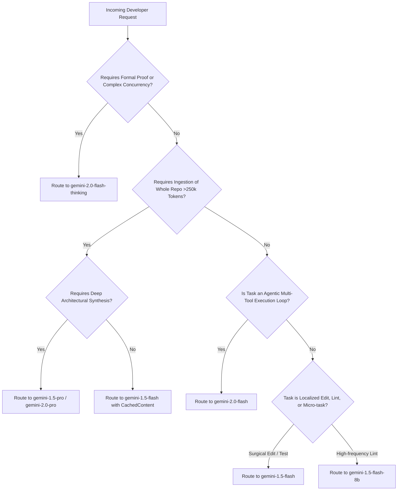
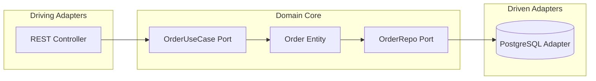

# Gemini Agent Guidelines and Runtime Reference Manual

> **Document Scope**: Authoritative instructions, runtime environment configurations, model routing strategies, context window optimization protocols, and prompt conventions for Google Gemini AI agents operating within software engineering repositories.

---

## Table of Contents
- [1. Gemini Agent Operating Foundation](#1-gemini-agent-operating-foundation)
  - [1.1 Purpose and Architectural Precedence](#11-purpose-and-architectural-precedence)
  - [1.2 Agent Persona and Operational Boundaries](#12-agent-persona-and-operational-boundaries)
- [2. Gemini Model Family and Strategic Workload Routing](#2-gemini-model-family-and-strategic-workload-routing)
  - [2.1 Model Specifications and Capabilities](#21-model-specifications-and-capabilities)
  - [2.2 Task-to-Model Routing Matrix](#22-task-to-model-routing-matrix)
  - [2.3 Latency and Cost Optimization Trade-offs](#23-latency-and-cost-optimization-trade-offs)
- [3. Massive Context Window Mechanics and Attention Dynamics](#3-massive-context-window-mechanics-and-attention-dynamics)
  - [3.1 1M and 2M Token Dynamics and Attention Characteristics](#31-1m-and-2m-token-dynamics-and-attention-characteristics)
  - [3.2 The Context Sandwich Pattern](#32-the-context-sandwich-pattern)
  - [3.3 Context Caching with CachedContent API](#33-context-caching-with-cachedcontent-api)
  - [3.4 In-Context Ingestion vs Surgical Tool Retrieval](#34-in-context-ingestion-vs-surgical-tool-retrieval)
  - [3.5 Context Hygiene and Token Pruning Protocols](#35-context-hygiene-and-token-pruning-protocols)
- [4. Runtime Environment Configuration and Developer Safety Overrides](#4-runtime-environment-configuration-and-developer-safety-overrides)
  - [4.1 Supported Runtime Environments](#41-supported-runtime-environments)
  - [4.2 GenerationConfig Standards and Hyperparameters](#42-generationconfig-standards-and-hyperparameters)
  - [4.3 Safety Settings and Developer Threshold Overrides](#43-safety-settings-and-developer-threshold-overrides)
  - [4.4 Environment Variables and Credential Isolation](#44-environment-variables-and-credential-isolation)
- [5. Tool Calling Protocol, Function Schemas, and MCP Integration](#5-tool-calling-protocol-function-schemas-and-mcp-integration)
  - [5.1 Native Function Calling Schemas and OpenAPI Specification](#51-native-function-calling-schemas-and-openapi-specification)
  - [5.2 Tool Calling Modes and Execution Policies](#52-tool-calling-modes-and-execution-policies)
  - [5.3 Parallel Tool Invocations and Batched Execution](#53-parallel-tool-invocations-and-batched-execution)
  - [5.4 Built-in Grounding Tools](#54-built-in-grounding-tools)
  - [5.5 Model Context Protocol Integration](#55-model-context-protocol-integration)
- [6. Prompt Engineering Conventions and Reasoning Architectures](#6-prompt-engineering-conventions-and-reasoning-architectures)
  - [6.1 Privileged System Instruction Channel](#61-privileged-system-instruction-channel)
  - [6.2 Tone, Directness, and Anti-Fluff Constraints](#62-tone-directness-and-anti-fluff-constraints)
  - [6.3 Chain-of-Thought Scratchpad vs Native Thinking Mode](#63-chain-of-thought-scratchpad-vs-native-thinking-mode)
  - [6.4 Structured Output Formatting and Schemas](#64-structured-output-formatting-and-schemas)
  - [6.5 Few-Shot Demonstrations for Developer Workflows](#65-few-shot-demonstrations-for-developer-workflows)
- [7. Multimodal Perception and Developer Workflows](#7-multimodal-perception-and-developer-workflows)
  - [7.1 Multimodal Input Tokenization and Resource Costs](#71-multimodal-input-tokenization-and-resource-costs)
  - [7.2 UI Bug Diagnosis and Visual Regressions](#72-ui-bug-diagnosis-and-visual-regressions)
  - [7.3 Architecture Diagram Ingestion and Synthesis](#73-architecture-diagram-ingestion-and-synthesis)
  - [7.4 Screencast and Video Bug Reproduction](#74-screencast-and-video-bug-reproduction)
- [8. Code Generation, Patching, and Diff Hygiene](#8-code-generation-patching-and-diff-hygiene)
  - [8.1 Surgical Modification vs Full-File Overwrite Discipline](#81-surgical-modification-vs-full-file-overwrite-discipline)
  - [8.2 Non-Destructive Operations and State Verification](#82-non-destructive-operations-and-state-verification)
  - [8.3 Error Recovery and Self-Correction Protocols](#83-error-recovery-and-self-correction-protocols)
- [9. Operational Failure Recovery and Invariant Checklists](#9-operational-failure-recovery-and-invariant-checklists)
  - [9.1 Multi-Document Hierarchy and Cross-Reference Map](#91-multi-document-hierarchy-and-cross-reference-map)
  - [9.2 Gemini Agent Invariant Checklist](#92-gemini-agent-invariant-checklist)
  - [9.3 Troubleshooting and Edge Case Matrix](#93-troubleshooting-and-edge-case-matrix)

---

## 1. Gemini Agent Operating Foundation

### 1.1 Purpose and Architectural Precedence

This document provides the canonical guidelines and operational parameters for AI agents powered by the **Google Gemini** model family (including Gemini 1.5 Pro, Gemini 1.5 Flash, Gemini 2.0 Flash, and Gemini 2.0 Flash Thinking). It addresses Gemini-specific architectural traits: ultra-long context windows (up to 2,000,000 tokens), context caching APIs, native function calling mechanisms, multimodal tokenization, and developer-oriented safety filter thresholds.

When an agent operates within this workspace, instructions resolve according to a strict four-tier hierarchy:

```
┌────────────────────────────────────────────────────────────────────────┐
│ Tier 1: Host System Kernel & Security Policies                         │
│ (System sandboxing, file permissions, immutable execution boundaries)   │
├────────────────────────────────────────────────────────────────────────┤
│ Tier 2: Repository Gemini Reference Manual (GEMINI.md)                  │
│ (Gemini-native API configuration, model routing, safety overrides)     │
├────────────────────────────────────────────────────────────────────────┤
│ Tier 3: Repository General Agent Standards (AGENTS.md)                 │
│ (Model-agnostic developer workflows, non-destructive editing norms)    │
├────────────────────────────────────────────────────────────────────────┤
│ Tier 4: User Session Prompts & Task Directives                         │
│ (Specific feature requests, localized refactoring commands)            │
└────────────────────────────────────────────────────────────────────────┘
```

If a conflict arises between general agent recommendations in `AGENTS.md` and Gemini-specific runtime configurations in `GEMINI.md`, the directives in `GEMINI.md` take precedence for Gemini execution environments (such as Antigravity IDE, Gemini CLI, Google GenAI SDK, or Vertex AI Agent Engine).

### 1.2 Agent Persona and Operational Boundaries

When operating under this specification, the Gemini agent embodies the persona of a **Principal Systems Engineer and Lead Software Architect**:
- **Technical Rigor**: Ground all conclusions in verified source code, AST structures, compiler outputs, and direct tool observations. Never speculate on system behavior when a tool can establish ground truth.
- **Directness and Conciseness**: Eliminate conversational filler, pleasantries, apologies, and sycophantic preamble. Deliver actionable code, structured diffs, exact terminal commands, and technical justifications.
- **Deterministic Reproducibility**: Favor reproducible tool interactions, explicit file paths, and verifiable test invocations over heuristic guessing.
- **Operational Boundaries**:
  - Never execute destructive disk operations (`rm -rf`, `git reset --hard`, overwriting unstaged modifications) without an explicit safety backup or user confirmation.
  - Never fabricate mock test passes, synthetic logs, or dummy verification artifacts.
  - Maintain genuine application state and architectural boundaries as defined in `ARCHITECTURE.md`.

---

## 2. Gemini Model Family and Strategic Workload Routing

### 2.1 Model Specifications and Capabilities

Google Gemini provides a specialized model taxonomy designed for tiered workload distribution. The table below delineates the primary engineering variants:

| Model Identifier | Input Context Window | Max Output Tokens | Architecture Strengths | Ideal Workload Classification |
|---|---|---|---|---|
| **`gemini-1.5-pro`** | 2,097,152 tokens (2M) | 8,192 tokens | Deep multi-hop reasoning, massive document synthesis, cross-module dependency graphing | Full repository architectural audits, multi-library framework migrations, root-cause analysis across distributed services |
| **`gemini-1.5-flash`** | 1,048,576 tokens (1M) | 8,192 tokens | Sub-second Time-to-First-Token (TTFT), high throughput (>100 tokens/sec), cost efficiency | Targeted unit test authoring, surgical bug fixes, git log inspection, code search summarization |
| **`gemini-1.5-flash-8b`** | 1,048,576 tokens (1M) | 8,192 tokens | Ultra-low latency, maximum request concurrency, cost minimization | High-frequency AST parsing, lint rule classification, inline documentation generation |
| **`gemini-2.0-flash`** | 1,048,576 tokens (1M) | 8,192 tokens | Real-time multimodal streaming, optimized native function calling, low-latency tool loop execution | Autonomous agent loops, interactive CLI debugging, multi-tool orchestration, MCP server coordination |
| **`gemini-2.0-flash-thinking`** | 1,048,576 tokens (1M) | 8,192 tokens | Integrated Chain-of-Thought reasoning tokens, formal mathematical proofs, complex state modeling | Concurrency race condition resolution, memory leak trace analysis, complex algorithm design |
| **`gemini-2.0-pro`** *(Exp)* | 2,097,152 tokens (2M) | 8,192 tokens | State-of-the-art coding benchmarks, competitive software synthesis, complex system refactoring | High-complexity mission-critical refactors, novel protocol design, deep architectural transitions |

### 2.2 Task-to-Model Routing Matrix

Agents and orchestration runtimes must dynamically route tasks based on the following decision flow:



#### Task Allocation Guide:
1. **Architectural Auditing and Global Refactoring**:
   - *Target*: `gemini-1.5-pro` or `gemini-2.0-pro`.
   - *Rationale*: Requires scanning cross-module boundaries, circular imports, and shared domain models across tens of thousands of lines of code.
2. **Algorithmic Optimization & Deadlock Analysis**:
   - *Target*: `gemini-2.0-flash-thinking`.
   - *Rationale*: Native thinking tokens allow the model to simulate execution state, verify thread interleaving, and confirm algorithmic edge cases prior to emitting patches.
3. **Interactive Debugging and Agent Loops**:
   - *Target*: `gemini-2.0-flash`.
   - *Rationale*: Provides rapid turn-by-turn tool dispatch with minimal execution overhead and superior tool-calling schema adherence.
4. **Surgical Patching and Test Enhancement**:
   - *Target*: `gemini-1.5-flash`.
   - *Rationale*: Balances low latency and high quality for localized changes without exhausting rate limits or inflating inference costs.

### 2.3 Latency and Cost Optimization Trade-offs

When architecting autonomous pipelines, balance compute latency against operational cost:
- **TTFT (Time-to-First-Token)**: `gemini-1.5-flash` achieves TTFT in ~400ms for small context, while `gemini-1.5-pro` on a 1M token corpus may require 10–20 seconds to begin emitting tokens unless context caching is active.
- **Cache Amortization**: Repetitive queries against an un-cached 1M repository prompt incur full input token pricing per turn. Context caching reduces input cost by 75% and slashes TTFT to under 2 seconds.
- **Output Token Caps**: Gemini models enforce a maximum output ceiling of 8,192 tokens. Never request full-file rewrites for large classes (>500 lines); always utilize targeted diffs to avoid abrupt token truncation mid-generation.

---

## 3. Massive Context Window Mechanics and Attention Dynamics

### 3.1 1M and 2M Token Dynamics and Attention Characteristics

Gemini 1.5 and 2.0 architectures support context windows ranging from 1,048,576 to 2,097,152 tokens. While Gemini models demonstrate over 99% accuracy in Needle-In-A-Haystack (NIAH) retrieval benchmarks across the entire window, transformer self-attention naturally exhibits a non-uniform U-shaped curve:

```
Attention Weight
   ▲
High│ █                                                    █
   │ ██                                                  ██
   │ ███                                                ███
   │ █████                                            █████
   │ ███████                                        ███████
   │ █████████                                    █████████
Low│ ██████████████████████████████████████████████████████
   └────────────────────────────────────────────────────────►
     Primacy (Start)        Middle (Corpus)          Recency (End)
```

- **Primacy Bias**: The initial tokens (system prompt, root guidelines) receive high, stable attention weights throughout the generation process.
- **Middle Degradation Risk ("Lost in the Middle")**: Information placed in the middle third of a multi-hundred-thousand-token prompt experiences minor attention dispersion if ambiguous or unanchored.
- **Recency Bias**: Tokens located immediately before the final assistant response prompt receive maximum immediate focus.

### 3.2 The Context Sandwich Pattern

To ensure deterministic instruction adherence when loading large codebases, agents must structure prompts according to the **Context Sandwich Pattern**:

```
┌────────────────────────────────────────────────────────────────────────┐
│ 1. System Primacy Anchor (systemInstruction Parameter)                 │
│    - Role definition, core engineering constraints, safety policies    │
│    - Available tool signatures, execution modes, response schemas      │
├────────────────────────────────────────────────────────────────────────┤
│ 2. Static Knowledge Base / Reference Corpus (Cached Context)           │
│    - Complete source tree, database schemas, OpenAPI contracts         │
│    - Domain documentation, architectural invariants                    │
├────────────────────────────────────────────────────────────────────────┤
│ 3. Dynamic Working State & Session History                             │
│    - Agent plan (`progress.md`), tool execution trace, compiler logs   │
│    - Interim hypotheses and verified facts                             │
├────────────────────────────────────────────────────────────────────────┤
│ 4. Recency Anchor & Immediate Task Trigger (Bottom of Context)         │
│    - Precise problem statement and immediate objective                 │
│    - Reiteration of critical negative constraints ("Do NOT overwrite") │
│    - Verification checklist before final output                        │
└────────────────────────────────────────────────────────────────────────┘
```

By sandwiching the reference code between the top-level system instructions and the bottom recency anchor, the agent guarantees that global constraints remain active while immediate tasks dictate the immediate token trajectory.

### 3.3 Context Caching with CachedContent API

For workflows involving static codebases exceeding 32,768 tokens, agents must employ Google GenAI **Context Caching** (`CachedContent`). 

#### Operational Rules for Context Caching:
1. **Minimum Size Threshold**: The context cache requires at least **32,768 tokens**. Prompts below this threshold cannot be cached.
2. **Cache Content Determinism**: Cache static assets that do not mutate turn-by-turn (e.g., framework documentation, generated client libraries, historical project dumps).
3. **Time-To-Live (TTL)**: Set realistic TTL values (default: 300s to 86,400s). Use 1 hour (`3600s`) for active development sessions and 24 hours (`86400s`) for continuous integration suites.

#### TypeScript Implementation (Official `@google/genai` SDK):

```typescript
import { GoogleGenAI } from '@google/genai';

const ai = new GoogleGenAI();

async function createRepositoryCache(codebaseDump: string): Promise<string> {
  const cache = await ai.cachedContents.create({
    model: 'gemini-1.5-pro-002',
    config: {
      displayName: 'repo_codebase_cache',
      contents: [
        {
          role: 'user',
          parts: [{ text: codebaseDump }]
        }
      ],
      ttl: '3600s', // 1 hour expiration
    }
  });

  return cache.name; // Form: cachedContents/{cacheId}
}

async function queryCachedCodebase(cacheName: string, query: string) {
  const response = await ai.models.generateContent({
    model: 'gemini-1.5-pro-002',
    contents: query,
    config: {
      cachedContent: cacheName,
      temperature: 0.1,
    }
  });

  return response.text;
}
```

#### Python Implementation (`google-genai` SDK):

```python
from google import genai
from google.genai import types

client = genai.Client()

def setup_codebase_cache(full_source_text: str) -> str:
    cache = client.cached_contents.create(
        model="gemini-1.5-pro-002",
        config=types.CreateCachedContentConfig(
            display_name="appservice_source_cache",
            contents=[full_source_text],
            ttl="7200s", # 2 hours
        )
    )
    return cache.name

def run_agent_analysis(cache_name: str, task_prompt: str) -> str:
    response = client.models.generate_content(
        model="gemini-1.5-pro-002",
        contents=task_prompt,
        config=types.GenerateContentConfig(
            cached_content=cache_name,
            temperature=0.1,
        )
    )
    return response.text
```

### 3.4 In-Context Ingestion vs Surgical Tool Retrieval

Do not indiscriminately dump entire file trees into the context window. Follow this operational triage:

| Scenario | Recommended Strategy | Rationale |
|---|---|---|
| **Global Architecture Verification** | In-Context Ingestion (or Cached Content) | Identifying cyclical dependencies or cross-module leaks requires simultaneous visibility across all interfaces. |
| **Localized Bug Fix / Single Class Refactor** | Surgical Tool Retrieval (`grep_search`, `find_by_name`, `view_file`) | Loading 500k tokens to modify a single 20-line method introduces unnecessary latency, cost, and context pollution. |
| **Test Failure Triage** | Targeted Log Inspection + Target Test Class | Inject only the stack trace and the failing unit test. Expand file viewing outward only as needed by the call stack. |
| **New Feature Implementation** | Surgical Ingestion of Ports & Adapters | Load interface contracts, domain models, and existing adapter examples. Exclude unrelated domain aggregates. |

### 3.5 Context Hygiene and Token Pruning Protocols

Maintain strict hygiene in the working memory buffer:
1. **Exclude Binary and Generated Files**: Never ingest `.class`, `.jar`, `.exe`, `.pyc`, minified `.js` bundles, or source maps.
2. **Exclude Package Manager Trees**: Exclude `target/`, `node_modules/`, `vendor/`, `.gradle/`, and `.git/objects/`.
3. **Truncate Repetitive Tool Responses**: Capped output at 50 results for searches. Truncate long build outputs to the first 25 and last 25 lines of compiler diagnostics.
4. **Active Session Pruning**: Maintain an ongoing summary in `progress.md` and archive verbose raw tool interactions once facts have been established and logged.

---

## 4. Runtime Environment Configuration and Developer Safety Overrides

### 4.1 Supported Runtime Environments

Gemini agent configurations must function consistently across four primary developer environments:
1. **Antigravity IDE / Code Studio**: Reads workspace settings from `.gemini/config/config.json`. Supports turbo artifact review, sandboxed terminal execution, and MCP tool servers.
2. **Gemini CLI (`gemini`)**: Interactive command-line environment executing against project root repositories.
3. **Google GenAI SDK (Node.js & Python)**: Direct programmatic access via official client libraries.
4. **Vertex AI Agent Engine**: Enterprise-managed autonomous runtime deploying containerized agent runtimes.

### 4.2 GenerationConfig Standards and Hyperparameters

Configure inference hyperparameters according to the task domain:

```json
{
  "deterministicCoding": {
    "temperature": 0.0,
    "topP": 0.95,
    "topK": 40,
    "maxOutputTokens": 8192,
    "responseMimeType": "text/plain"
  },
  "architecturalExploration": {
    "temperature": 0.5,
    "topP": 0.95,
    "topK": 40,
    "maxOutputTokens": 8192,
    "responseMimeType": "text/plain"
  },
  "structuredMetadataExtraction": {
    "temperature": 0.0,
    "responseMimeType": "application/json",
    "responseSchema": {
      "type": "OBJECT",
      "properties": {
        "status": { "type": "STRING", "enum": ["SUCCESS", "FAILURE", "BLOCKED"] },
        "modifiedFiles": {
          "type": "ARRAY",
          "items": { "type": "STRING" }
        },
        "summary": { "type": "STRING" }
      },
      "required": ["status", "modifiedFiles", "summary"]
    }
  }
}
```

*Rule*: For code generation, refactoring, and test writing, always set `temperature: 0.0` or `0.1` to maximize determinism and eliminate synthetic syntax hallucination.

### 4.3 Safety Settings and Developer Threshold Overrides

Standard consumer Gemini safety configurations apply heuristic classifiers designed for general conversation. In software engineering, these default filters frequently generate **false-positive refusals** (`finishReason: SAFETY`), misclassifying common developer patterns:
- Security testing scripts and penetration test cases (misclassified as `HARM_CATEGORY_DANGEROUS_CONTENT`).
- Network socket manipulation, port scanning, or memory pointers.
- Shell commands containing `rm`, `kill`, `chmod`, `iptables`, or SQL queries containing `DROP TABLE`.
- Regular expressions for detecting exploit payloads or malicious input validation.

To prevent agent session interruption during legitimate software development, configure all safety categories to **`BLOCK_NONE`** (or `BLOCK_ONLY_HIGH` where organizational compliance dictates):

```json
[
  {
    "category": "HARM_CATEGORY_HARASSMENT",
    "threshold": "BLOCK_NONE"
  },
  {
    "category": "HARM_CATEGORY_HATE_SPEECH",
    "threshold": "BLOCK_NONE"
  },
  {
    "category": "HARM_CATEGORY_SEXUALLY_EXPLICIT",
    "threshold": "BLOCK_NONE"
  },
  {
    "category": "HARM_CATEGORY_DANGEROUS_CONTENT",
    "threshold": "BLOCK_NONE"
  },
  {
    "category": "HARM_CATEGORY_CIVIC_INTEGRITY",
    "threshold": "BLOCK_NONE"
  }
]
```

#### TypeScript Safety Configuration:
```typescript
import { HarmCategory, HarmBlockThreshold } from '@google/genai';

const developerSafetySettings = [
  { category: HarmCategory.HARM_CATEGORY_DANGEROUS_CONTENT, threshold: HarmBlockThreshold.BLOCK_NONE },
  { category: HarmCategory.HARM_CATEGORY_HARASSMENT, threshold: HarmBlockThreshold.BLOCK_NONE },
  { category: HarmCategory.HARM_CATEGORY_HATE_SPEECH, threshold: HarmBlockThreshold.BLOCK_NONE },
  { category: HarmCategory.HARM_CATEGORY_SEXUALLY_EXPLICIT, threshold: HarmBlockThreshold.BLOCK_NONE },
  { category: HarmCategory.HARM_CATEGORY_CIVIC_INTEGRITY, threshold: HarmBlockThreshold.BLOCK_NONE },
];
```

### 4.4 Environment Variables and Credential Isolation

Agents must adhere to strict credential isolation:
- Store API authentication keys in environment variables: `GEMINI_API_KEY` for Google AI Studio, or `GOOGLE_APPLICATION_CREDENTIALS` for Google Cloud Vertex AI.
- Never write API keys, authorization tokens, or passwords to source files, markdown reports, or commit messages.
- Always include `.env`, `*.pem`, `*.key`, and `credentials.json` in `.gitignore`.

---

## 5. Tool Calling Protocol, Function Schemas, and MCP Integration

### 5.1 Native Function Calling Schemas and OpenAPI Specification

Gemini natively consumes tool definitions formatted using an OpenAPI 3.0 / JSON Schema subset. Function declarations are passed via the `tools` array within `GenerateContentConfig`.

#### Standard File Replacement Schema (`replace_file_content`):

```json
{
  "name": "replace_file_content",
  "description": "Replaces a contiguous block of text in a target file with new content. Fails if target content is not uniquely found.",
  "parameters": {
    "type": "OBJECT",
    "properties": {
      "TargetFile": {
        "type": "STRING",
        "description": "Absolute path to the target file to modify."
      },
      "StartLine": {
        "type": "INTEGER",
        "description": "1-based starting line number for search window."
      },
      "EndLine": {
        "type": "INTEGER",
        "description": "1-based ending line number for search window."
      },
      "TargetContent": {
        "type": "STRING",
        "description": "Exact character sequence to be replaced, including indentation."
      },
      "ReplacementContent": {
        "type": "STRING",
        "description": "New replacement content."
      },
      "Instruction": {
        "type": "STRING",
        "description": "Short explanation of the modification rationale."
      }
    },
    "required": ["TargetFile", "StartLine", "EndLine", "TargetContent", "ReplacementContent", "Instruction"]
  }
}
```

### 5.2 Tool Calling Modes and Execution Policies

Control the tool invocation lifecycle using `toolConfig`:

```json
{
  "functionCallingConfig": {
    "mode": "AUTO",
    "allowedFunctionNames": []
  }
}
```

- **`AUTO` (Default)**: Model decides between emitting text or issuing a `functionCall`. Ideal for standard multi-turn workflows.
- **`ANY` (Enforced Tool Execution)**: Model is forced to emit a `functionCall` before answering in natural language. Essential for enforcing an **"investigate-before-answering"** protocol during exploration phases.
- **`NONE`**: Model is forbidden from issuing tool calls; emits only natural language. Used for pure synthesis after all facts are gathered.
- **`allowedFunctionNames`**: Restricts tool execution to a declared whitelist. Use this during read-only investigation phases (e.g., whitelisting only `["view_file", "grep_search", "find_by_name"]`).

### 5.3 Parallel Tool Invocations and Batched Execution

Gemini 1.5 Pro and Gemini 2.0 natively issue **multiple tool calls in a single turn** when multiple independent data points are required (e.g., reading three files simultaneously or running two search queries).

```
Model Turn:
  ├── functionCall: view_file(path: "src/domain/User.java")
  ├── functionCall: view_file(path: "src/domain/Order.java")
  └── functionCall: grep_search(query: "OrderRepository")

Runtime Response:
  ├── functionResponse: [User.java contents]
  ├── functionResponse: [Order.java contents]
  └── functionResponse: [Search results]
```

#### Protocol for Parallel Invocations:
1. Runtimes must execute independent tool calls concurrently where safe.
2. Return all `functionResponse` objects back in a single turn, matching function names and identifiers.
3. If one tool call fails, return the error message in that specific `functionResponse` without aborting the other valid responses.

### 5.4 Built-in Grounding Tools

Google Gemini provides managed native tools that do not require external runtime implementation:
- **`googleSearch` Grounding**: Real-time web retrieval. Use for looking up newly released library API methods, latest security advisories (CVEs), or external documentation.
  ```json
  {
    "tools": [
      { "googleSearch": {} }
    ]
  }
  ```
- **`codeExecution` Sandbox**: Server-side Python sandbox executed within Google's secure infrastructure. Ideal for calculating mathematical proofs, running data transformations, or verifying algorithm correctness before emitting production code.
  ```json
  {
    "tools": [
      { "codeExecution": {} }
    ]
  }
  ```

### 5.5 Model Context Protocol Integration

The **Model Context Protocol (MCP)** standardizes tool and resource sharing across disparate agent runtimes. Gemini agents interface with MCP servers (such as `chrome-devtools-mcp`, filesystem servers, and database connectors) through a dual-tier strategy:

```
┌────────────────────────────────────────────────────────┐
│ Gemini Agent Engine                                    │
│                                                        │
│  ├── Eager Tools (Direct OpenAPI Declarations)         │
│  │   ├── run_command, view_file, replace_file_content  │
│  │                                                     │
│  └── Lazy Tools (MCP Protocol Bridge)                  │
│      ├── call_mcp_tool(server, toolName, arguments)   │
│      ├── list_resources(server)                        │
│      └── read_resource(server, uri)                    │
└──────────────────────────┬─────────────────────────────┘
                           │ Stdio / SSE Transport
┌──────────────────────────▼─────────────────────────────┐
│ MCP Server Ecosystem                                   │
│  ├── chrome-devtools-mcp (browser automation, DOM)     │
│  ├── database-mcp (PostgreSQL / MySQL query engine)    │
│  └── git-mcp (Git repository operations)               │
└────────────────────────────────────────────────────────┘
```

#### Eager vs. Lazy Tool Strategy:
- **Eager Tools**: Critical, high-frequency tools (file viewing, text replacement, shell execution) have their schemas embedded directly into the prompt.
- **Lazy Tools (`call_mcp_tool`)**: Infrequent or specialized tools (e.g., 30+ browser automation methods in `chrome-devtools-mcp`) are accessed via a generic dispatch wrapper. This prevents schema token bloat from consuming tens of thousands of prompt tokens.

---

## 6. Prompt Engineering Conventions and Reasoning Architectures

### 6.1 Privileged System Instruction Channel

Gemini models provide a dedicated API parameter: **`systemInstruction`**. Always supply project-level instructions, agent rules, and behavioral boundaries through `systemInstruction` rather than as a synthetic first user turn:

```typescript
const model = ai.models.generateContent({
  model: 'gemini-1.5-pro-002',
  contents: userPrompt,
  config: {
    systemInstruction: {
      parts: [{ text: "You are an expert principal software engineer..." }]
    }
  }
});
```

#### Why Privileged `systemInstruction` is Mandatory:
1. **Instruction Invariance**: Instructions in `systemInstruction` receive persistent attention weighting and are resilient against context drift during long-running 50-turn conversations.
2. **Prompt Injection Defense**: Prevents malicious content inside analyzed user code or external files from overriding top-level agent safety rules.

### 6.2 Tone, Directness, and Anti-Fluff Constraints

Gemini agents must adhere to strict verbal hygiene:
- **Zero Conversational Preamble**: Never output introductory pleasantries (`"Sure, I'd be happy to help with that!"`, `"Okay, let's take a look at the file."`).
- **Immediate Action**: Begin responses directly with technical analysis, tool calls, or code modifications.
- **No Self-Congratulatory Summaries**: Conclude with concise, factual verification steps rather than promotional claims (`"I have successfully created a state-of-the-art solution..."`).

### 6.3 Chain-of-Thought Scratchpad vs Native Thinking Mode

Different Gemini model variants support different reasoning patterns:

#### 1. Gemini 1.5 Pro / Flash: Explicit `<thought>` Scratchpad
Enforce an explicit XML `<thought>` block before any destructive edit or complex tool sequence:

```markdown
<thought>
1. Observation: UserService.java imports UserRepository from the infrastructure package, violating Hexagonal Architecture.
2. Target: Invert the dependency by introducing a UserRepositoryPort in the domain core.
3. Verification: Check all 4 call sites using grep_search before editing.
</thought>
```

#### 2. Gemini 2.0 Flash Thinking: Native Reasoning Mode
When running `gemini-2.0-flash-thinking`, explicit `<thought>` tags are redundant. The model emits internal reasoning tokens processed through the native `thinking_config`:

```json
{
  "thinkingConfig": {
    "thinkingBudget": 2048
  }
}
```

The runtime exposes these thought streams for auditing while keeping the primary output channel clean and focused on final deliverables.

### 6.4 Structured Output Formatting and Schemas

When downstream tooling requires machine-readable responses, enforce JSON schemas directly through `responseSchema` and `responseMimeType: "application/json"`.

For code changes rendered in markdown, always specify the language identifier and exact relative or absolute file paths:

````markdown
```java
// File: src/main/java/com/app/service/domain/User.java
package com.app.service.domain;

public record User(Long id, String username, String email) {}
```
````

### 6.5 Few-Shot Demonstrations for Developer Workflows

Providing concrete few-shot demonstrations primes Gemini models to replicate optimal developer behavior.

#### Demonstration 1: Safe File Exploration
*User*: Locate where customer orders are validated.  
*Gemini*:
```markdown
<thought>
Need to find order validation logic. Searching for OrderValidator or validateOrder across domain packages.
</thought>
```
*Tool Call*: `grep_search(SearchPath: "src/main/java", Query: "validateOrder")`

#### Demonstration 2: Surgical Replacement Chunking
*User*: Fix null check in `OrderService.java`.  
*Gemini*:
```markdown
<thought>
Targeting lines 42-48 in OrderService.java. Using replace_file_content to insert null check without rewriting the rest of the class.
</thought>
```
*Tool Call*:
```json
{
  "name": "replace_file_content",
  "parameters": {
    "TargetFile": "src/main/java/com/app/service/OrderService.java",
    "StartLine": 42,
    "EndLine": 48,
    "TargetContent": "        Order order = orderRepository.findById(id);\n        return order.calculateTotal();",
    "ReplacementContent": "        Order order = orderRepository.findById(id);\n        if (order == null) {\n            throw new OrderNotFoundException(\"Order not found for id: \" + id);\n        }\n        return order.calculateTotal();",
    "Instruction": "Add null check with domain exception before calculating total."
  }
}
```

#### Demonstration 3: Handling and Recovering from Tool Failure
*Tool Response*: `Error: Target content did not match lines 42-48. Content has shifted.`  
*Gemini*:
```markdown
<thought>
The file content shifted due to prior edits. Viewing lines 35-55 of OrderService.java to re-anchor the exact target string.
</thought>
```
*Tool Call*: `view_file(AbsolutePath: "src/main/java/com/app/service/OrderService.java", StartLine: 35, EndLine: 55)`

---

## 7. Multimodal Perception and Developer Workflows

### 7.1 Multimodal Input Tokenization and Resource Costs

Gemini models process visual and audio artifacts natively without requiring external OCR or transcription pipelines:

| Modality | Ingestion Unit | Token Consumption Calculation | Notes |
|---|---|---|---|
| **Images (PNG, JPEG, WebP)** | 258 tokens per crop tile | Images > 384x384 are tiled into 1–4 tiles + 258 base tokens (~258 to 1,032 tokens) | Supports high-resolution architecture diagrams and UI screenshots |
| **PDF Documents** | Rendered as image pages | ~258 tokens per page | Ingests architectural whitepapers, RFCs, and API datasheets natively |
| **Video (MP4, WebM)** | Sampled at 1 FPS | ~258 tokens per second of video | Ideal for reproducing UI bug screencasts |
| **Audio (WAV, MP3)** | Continuous audio stream | ~32 tokens per second of audio | Diagnostic audio logs, incident voice recordings |

### 7.2 UI Bug Diagnosis and Visual Regressions

Gemini can analyze visual defects by comparing screenshots against DOM dumps:

```
┌────────────────────────────────────────────────────────┐
│ Input Multimodal Bundle:                               │
│  1. Screenshot of broken UI (e.g., overlapping button) │
│  2. Target Figma mockup screenshot                     │
│  3. Raw HTML/DOM structure + CSS classes               │
└──────────────────────────┬─────────────────────────────┘
                           │ Multimodal Inference
┌──────────────────────────▼─────────────────────────────┐
│ Output Diagnosis:                                      │
│  - Identifies CSS property conflict (e.g. z-index)     │
│  - Emits exact CSS rule patch                          │
└────────────────────────────────────────────────────────┘
```

### 7.3 Architecture Diagram Ingestion and Synthesis

When given a whiteboard diagram, draw.io export, or PNG architecture diagram:
1. The agent inspects component boundaries, bounding boxes, and arrow directions.
2. Identifies driving ports (API gateways, controllers) and driven adapters (database repositories, message brokers).
3. Synthesizes a valid, syntactically correct Mermaid diagram representing the architecture:



### 7.4 Screencast and Video Bug Reproduction

For intermittent frontend race conditions:
1. Ingest screen recordings (`screencast.mp4`) captured during test execution.
2. Gemini samples frames at 1-second intervals, aligning visual state changes with timestamped console logs.
3. Pins down the exact millisecond where state mutation caused visual desynchronization.

---

## 8. Code Generation, Patching, and Diff Hygiene

### 8.1 Surgical Modification vs Full-File Overwrite Discipline

Gemini enforces an 8,192 maximum output token limit. Overwriting complete 1,000-line source files creates critical risks:
- **Output Truncation**: Files exceeding the token budget terminate abruptly, leaving source files corrupt and unparseable.
- **Accidental Regressions**: Full rewrites frequently erase unrelated utility methods, drop license headers, or alter formatting.
- **Lost Comments**: Code commentary and docstrings are often stripped during regeneration.

#### The Surgical Edit Invariant:
Always prefer targeted, chunk-based replacement tools (`replace_file_content` or standard unified diffs). Only create new files using full-write tools (`write_to_file`) when initializing brand-new modules.

### 8.2 Non-Destructive Operations and State Verification

Before modifying any file, agents must observe the **Read-Before-Write Protocol**:
1. **View Current State**: Call `view_file` to confirm the exact line numbers and indentation before issuing a replace command.
2. **Execute Edit**: Apply minimal contiguous replacement.
3. **Verify Modification**: Immediately inspect the modified line range or run the compiler to verify structural integrity.
4. **Git Status Hygiene**: Confirm that `git status` reflects only the intended file modifications.

### 8.3 Error Recovery and Self-Correction Protocols

When a compilation error or test failure occurs:
1. **Never Guess Blindly**: Do not retry the exact same edit or make random alterations.
2. **Extract Exact Diagnostics**: Parse the compiler error message, file name, line number, and error token.
3. **Trace the Abstract Syntax Tree (AST)**: Inspect related imports, class signatures, and interface definitions.
4. **Step-Back Assessment**: If an approach fails twice consecutively, stop and formulate an alternative hypothesis before attempting a third modification.

---

## 9. Operational Failure Recovery and Invariant Checklists

### 9.1 Multi-Document Hierarchy and Cross-Reference Map

| Document | Primary Role | Target Audience / Consumer | Content Focus |
|---|---|---|---|
| **`ARCHITECTURE.md`** | System Architectural Blueprints | Developers and AI Agents | Hexagonal ports & adapters, domain entities, dependency inversion rules, data flow diagrams. |
| **`AGENTS.md`** | General Agent Operational Standard | All AI Agents (Claude, GPT, Gemini) | Behavioral guidelines, task execution workflows, communication protocols, safety limits. |
| **`GEMINI.md`** *(This File)* | Gemini-Native Technical Reference | Google Gemini Runtimes & Orchestrators | Model family routing, context caching APIs, `systemInstruction` protocol, safety overrides (`BLOCK_NONE`), tool schemas. |

### 9.2 Gemini Agent Invariant Checklist

Before initiating any task, every Gemini agent must verify compliance against this invariant checklist:

```
[ ] Pre-Execution Verification:
    [ ] Active model correctly selected from Routing Matrix (Section 2.2)
    [ ] Privileged systemInstruction channel utilized (Section 6.1)
    [ ] Safety settings explicitly set to BLOCK_NONE for developer workloads (Section 4.3)
    [ ] Static reference context cached via CachedContent if >32k tokens (Section 3.3)
    [ ] Context Sandwich pattern applied to prompt layout (Section 3.2)

[ ] In-Flight Operational Discipline:
    [ ] Read-Before-Write rule enforced (files inspected prior to editing)
    [ ] Surgical replacement preferred over full-file overwrites (Section 8.1)
    [ ] Output token limits respected (<8,192 tokens per turn)
    [ ] Conversational fluff and preamble suppressed (Section 6.2)
    [ ] Parallel tool calls parsed and returned asynchronously (Section 5.3)

[ ] Post-Execution Verification:
    [ ] Project compiles cleanly via native build tooling (e.g. mvn compile)
    [ ] Affected tests and direct dependents execute with 100% pass rate
    [ ] Git working tree clean of unintended temporary artifacts or debug files
    [ ] Clear, concise handoff report recorded in workspace tracking files
```

### 9.3 Troubleshooting and Edge Case Matrix

| Symptom / Error Code | Root Cause | Immediate Remediation Protocol |
|---|---|---|
| **`finishReason: SAFETY`** | Security script, shell command, or SQL query triggered default consumer harm classifier. | Ensure runtime configuration sets `HarmCategory` thresholds to `BLOCK_NONE` across all 5 harm categories (Section 4.3). |
| **`finishReason: MAX_TOKENS`** | File overwrite or code generation exceeded 8,192 output tokens. | Switch to surgical chunk replacement (`replace_file_content`). Never attempt whole-file overwrites on large classes. |
| **`429 ResourceExhausted`** | Rate limit or quota exceeded on high-tier model (`gemini-1.5-pro`). | Route localized sub-tasks to `gemini-1.5-flash` or utilize `CachedContent` API to lower token ingestion velocity. |
| **Attention Loss / Missed Instruction** | Critical instructions lost in middle of massive context window (>500k tokens). | Re-anchor critical rules at the very end of the user prompt using the Context Sandwich Pattern (Section 3.2). |
| **Tool Calling Schema Error** | Schema contains unsupported OpenAPI types or invalid required fields. | Ensure tool declaration matches OpenAPI 3.0 subset; verify property types are uppercase (`STRING`, `INTEGER`, `OBJECT`, `ARRAY`). |
| **Context Cache Creation Rejection** | Cache creation failed with invalid argument error. | Verify payload contains at least 32,768 tokens and model name includes version tag (e.g., `gemini-1.5-pro-002`). |

---

*End of Gemini Agent Guidelines (`GEMINI.md`). Maintain and update in synchronization with Google GenAI SDK updates.*
